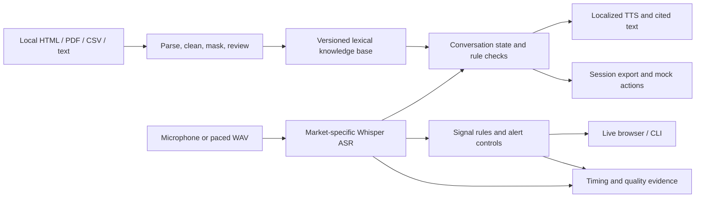

# Call Lab — Darwix assessment

A local app for grounded voice calls, a shared knowledge base, and live call alerts.

Read `ANSWERS.txt` or `ANSWERS.pdf` for the short explanation and measured results.

## What is real here

- A working FastAPI app and browser interface.
- Actual speech recognition using local faster-whisper, not transcript injection.
- Native Filipino and Indonesian synthetic voices through Edge TTS.
- HTML, PDF, table and text parsing, approved-source retrieval, citations, screening state and mock actions.
- Seven synthetic calls recorded from customer TTS through ASR and the running agent logic.
- Audio replay sent in chunks at real-time speed, with live alerts and measured latency.
- Automated tests, raw reports, a browser screenshot and a silent video walkthrough.

## What is not claimed

Only the assessment PDF was supplied. All business rules, account amounts and companies in the fixtures are fictional. No real customer calls, approved insurer rules, voice-platform credentials or native speakers were supplied. The app does not send messages, make payments, book callbacks, or connect a human. Synthetic tests are not evidence of real-world speech accuracy. This is a tested prototype, not a production launch.

## Run on Windows

Use Python 3.12. From this directory:

```powershell
py -3.12 -m venv .venv
.\.venv\Scripts\python.exe -m pip install -r requirements.txt
.\.venv\Scripts\python.exe scripts/seed_data.py
.\.venv\Scripts\python.exe -m uvicorn app:app --host 127.0.0.1 --port 8765
```

Open http://127.0.0.1:8765. Start a session, then type or use the microphone. Allow microphone access. Check the audio-processing box before speech use. Headphones help prevent feedback.

The first local ASR request downloads the `base` Whisper model. Internet is needed for that download and Edge TTS. Later recognition is local. No API key is required for the default path. If TTS is unavailable, the interface shows the answer as text. It does not silently substitute an English voice for another market.

Copy `.env.example` to `.env` only if changing settings. Optional Groq ASR uses `whisper-large-v3`. It is implemented but was not tested with an account. Do not commit `.env` or keys. `ASR_MODEL=small` is an option for further quality testing, with higher memory/CPU cost; reported tests use `base`.

## Run tests and reproduce evidence

```powershell
.\.venv\Scripts\python.exe -m pytest -q
.\.venv\Scripts\python.exe scripts/evaluate.py
.\.venv\Scripts\python.exe scripts/record_calls.py
.\.venv\Scripts\python.exe scripts/regional_probe.py
```

Keep the server running for these commands:

```powershell
.\.venv\Scripts\python.exe scripts/replay_audio.py
.\.venv\Scripts\python.exe -m playwright install chromium
.\.venv\Scripts\python.exe scripts/browser_check.py
.\.venv\Scripts\python.exe scripts/narrated_demo.py
.\.venv\Scripts\python.exe scripts/make_report.py
```

Do not run CPU-heavy evidence jobs together if comparing latency. Reports describe synthetic inputs and include failures. TTS output may change between runs. `runtime/tts` caches synthetic audio, but that cache is excluded from the submission.

`evidence/narrated_walkthrough.mp4` shows the running app with disclosed synthetic narration. It is not Ayush's voice. `WALKTHROUGH_SCRIPT.txt` is a guide for a personal recording. `scripts/package_submission.py` builds a zip of source and evidence while excluding secrets and installed packages.

## Question 1: candidate screening

The fictional internship uses two fields: a Python project and weekly available hours. The minimum-hours rule comes from the knowledge-base record, not a hidden prompt. The flow is consent, Python question, hours, preliminary result. Missing hours stay missing. Conflicting hours require confirmation. A result is not a job offer. Unknown questions get a fallback, and human requests produce a clearly marked local mock action.

The number requirement is met with a web calling interface, not a telephone number. Recordings are in `evidence/q1_*.wav` and transcripts/results in matching JSON files.

## Question 2: shared knowledge base

`scripts/seed_data.py` makes sample sources. `data/manifest.json` declares approved sections, topic, market, language, version and effective date. `core/kb.py` parses the local copies, cleans them, masks basic PII patterns and builds `data/kb.json`.

Records contain `record_id`, `title`, `content`, `category`, `topic`, `market`, `language`, `source_ref`, `version`, `effective_date`, `owner`, `sha256`, `pii_redacted` and `also_in`. Rules have a structured `rules` field. English variants for the Philippines have their own source references.

Small sections remain intact. Larger sections split at sentence boundaries around 160 words. This small demo uses BM25-style ranking and a keyword boost rather than embeddings. The same index powers search and the voice agent. No vector database is claimed. Answers are extracted from approved content, not invented by an LLM.

`evidence/retrieval_results.json` contains the question, actual record, source, expected topic, explanation, timing and verdict. `evidence/ingestion.json` shows duplicates, quarantined conflicting content and extraction failures.

## Question 3: local markets

- Philippines: fictional premium reminder, Filipino/Taglish, plus English when requested. Say `English please` or `Tagalog please` to select a reply language. Forced ASR language defaults to `tl`; an English request changes it to `en`.
- Indonesia: fictional installment reminder, Bahasa Indonesia, polite replies to colloquial input, local finance terms and a synthetic Javanese-voice stress test.
- Voice names: `fil-PH-BlessicaNeural`, `id-ID-GadisNeural`. Customer test voices use Angelo and Ardi. `jv-ID-DimasNeural` is a regional-language proxy, not validated real accented Indonesian.
- These are draft localizations. No native-speaker or legal review is claimed.

The small ASR model makes errors. Read the original reference alongside the recognized text in `evidence/q3_*.json`. A wrong or unclear recognition should lead to fallback, not an invented policy answer.

## Question 4: live insights

Microphone audio and replay files are processed in four-second chunks. Replays wait for each chunk's duration before sending it. They do not send the whole file for a post-call analysis. Speaker labels come from the selected channel; there is no inferred diarization.

Rules detect second-vehicle interest, risky approval promises, missing demo disclosure before a payment request, frustration, payment difficulty, callback needs and buying intent. Alerts only recommend a next step. There is no automated financial action.

Controls: ASR score cutoff 0.50, short-input filter, negation checks, 30-second per-signal cooldown, topic labels, priorities, at most two alerts per chunk and a 20-second display expiry. A short per-speaker context joins phrases across chunks. These are heuristic controls, not calibrated probabilities. The threshold was adjusted after the first synthetic test missed valid signals; it needs a held-out human test set.

No LLM is used for alerts, so LLM latency is zero. Reports include ASR, rule time, HTTP/delivery time, complete-chunk-to-display time and start-of-chunk-to-display time. The last measure includes the capture buffer. Do not quote server-only time as end-to-end latency.

## Architecture



## Main files

| File | Purpose |
|---|---|
| `app.py` | Local API and sessions |
| `core/kb.py` | Parsing, cleaning, PII masking, retrieval |
| `core/agent.py` | Conversation state, qualification, fallback |
| `core/speech.py` | ASR and TTS |
| `core/insights.py` | Live alerts and suppression |
| `web/` | Browser UI, microphone and paced replay |
| `tests/test_core.py` | Core and API tests |
| `scripts/` | Source generation, evidence and report tools |
| `evidence/` | Real outputs from synthetic tests |

## Before a real deployment

Keep this on localhost. There is no user authentication, tenant isolation, production rate limiting or durable job system. The local demo has a 100-session cap and expires idle sessions on new-session creation. Use TLS and authentication before exposing it. Add tenant-specific approved sources, stronger PII detection, deletion controls, encrypted audit storage and consent rules reviewed by the business. Avoid logging raw customer audio or account data by default.

At 10x load, the single locked CPU speech model and in-memory sessions become bottlenecks. Use shared session storage, bounded job queues, separate ASR workers, cancellation, backpressure and per-tenant limits. Test GPU or managed streaming ASR. Add load tests before choosing worker counts. The browser shows dropped chunks instead of silently accumulating an unlimited queue.

On noisy audio, use speech detection, longer context or overlapping chunks, better ASR, and explicit confirmation for dates, amounts and negation. The noise test here is low-level synthetic noise; it does not cover busy offices, phone codecs or overlapping speakers.

## References used

- faster-whisper implementation and CPU usage: https://github.com/SYSTRAN/faster-whisper
- Edge TTS and voice selection: https://github.com/rany2/edge-tts
- Optional Groq speech API: https://console.groq.com/docs/speech-to-text
- Browser speech voice availability: https://developer.mozilla.org/en-US/docs/Web/API/SpeechSynthesis/getVoices

No real insurer or lender policy is sourced from these links. They are technical references only.
